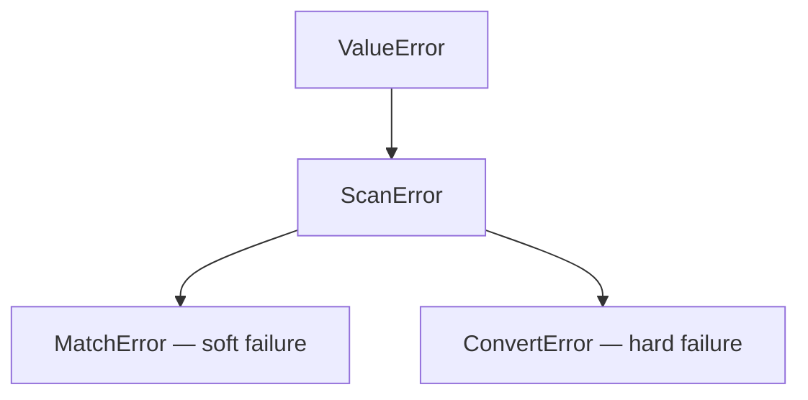

# Engine — Converter, Template & Errors

## Overview

The `engine` module is the runtime backbone of InfinityParse: it defines
`Converter` (per-field configuration data), `Field` (a field's converter branch
set), `Template` (a compiled template) and the error hierarchy. The high-level
[scanner](scanner.md) entry points normalize annotation metadata into a `Field`
sequence at construction time and hand it to `Template` for compilation.

---

## Converter — Per-Field Configuration

```python
@dataclass(frozen=True)
class Converter[T]:
    fn: Callable[[str], T]  # conversion callable: captured text -> T
    pattern: str = r".+?"  # capture pattern (lazy, non-empty, single-line)
    strip: bool = True  # strip the captured text before converting
    name: str | None = None  # display label used in error messages
    flags: int = 0  # re flags applied to the pattern
```

| Parameter | Type | Default | Description |
| - | - | - | - |
| `fn` | `Callable[[str], T]` | (required) | The conversion callable. Any exception it raises is wrapped into `ConvertError`. |
| `pattern` | `str` | `.+?` | This branch's capture pattern; branches of one field each carry their own. |
| `strip` | `bool` | `True` | Strips the captured text before converting; `False` keeps raw whitespace (e.g. `t.Whitespace` needs it). |
| `name` | `str \| None` | `None` | Display label in error messages; falls back to `fn.__name__`. |
| `flags` | `int` | `0` | `re` flags applied to this branch's own pattern. Supported inline subset: `i` / `m` / `s` / `x` / `a`; unsupported bits raise `ValueError` at compile time. |

Usage examples:

```python
import json
import re
from typing import Annotated

from infinity_parse import Converter, scan

# Custom conversion callable (JSON instead of Python literals, say)
scan[Annotated[dict[str, str], Converter(json.loads, name="json")]]("{}")(
    '{"key": "value"}'
)  # ({"key": "value"},)

# Custom pattern + label (friendlier error messages)
scan[Annotated[int, Converter(int, pattern=r"\d+", name="age")]]("age={}")(
    "age=42"
)  # (42,)

# strip=False: keep the whitespace inside the field
scan[Annotated[str, Converter(str, strip=False)]]("{}!")("hi !")  # ("hi ",)

# flags: applied to this branch's own pattern
scan[Annotated[str, Converter(str, pattern=r"[a-z]+", flags=re.IGNORECASE)]]("{}")(
    "HeLLo"
)  # ("HeLLo",)
```

> `Converter` is a frozen dataclass: safe to store and reuse. It participates in
> the template compile cache, so `fn` must be hashable.

### Escape-Aware String Fields

Extend the pattern to be escape-aware and let `json.loads` decode escapes;
malformed escapes fail hard in the converter (never silently):

```python
import json
from typing import Annotated

from infinity_parse import Converter, scan

parse_name = scan[
    Annotated[str, Converter(json.loads, pattern=r'"(?:[^"\\]|\\.)*"', name="name")]
]("{}")

parse_name(r'"kim \"the fox\""')  # ('kim "the fox"',)
parse_name(r'"C:\\path\\to\\file"')  # ('C:\\path\\to\\file',)
```

### Capturing Large Blobs

The default `.+?` is lazy — designed for fields followed by an anchor: it expands
one character at a time to find the shortest match. For a large capture with no
following anchor (a document body, say) that is expensive on CPython: a 1 MB
capture measures ~**8 ms**, while an explicit greedy DOTALL pattern takes
~**1 µs**:

```python
from typing import Annotated

from infinity_parse import Converter, scan

Blob = Annotated[str, Converter(str, pattern=r"(?s:.+)")]
parse_doc = scan[Blob]("{}")

parse_doc("arbitrarily large text…")  # near-zero overhead at any size
```

Do not change the default — shortest-match (lazy) semantics are the heart of
the template design.

### Scanners Inside Converters

`Converter.fn` may be another scanner — the outer pattern captures the field, then
the inner scanner parses it:

```python
from typing import Annotated

from infinity_parse import Converter, scan

point = scan[int, int]("{} {}")
parse = scan[
    Annotated[
        tuple[int, int], Converter(point, pattern=r"(?<=\[).+?(?=\])", name="point")
    ]
]("point=[{}]")

parse("point=[1 2]")  # ((1, 2),)
```

An inner failure surfaces as a `ConvertError`, whose `__cause__` chain points at
the inner `ScanError`.

---

## Field — The Converter Branch Set

```python
@dataclass(frozen=True)
class Field:
    converters: tuple[Converter[Any], ...]  # in competition order; at least one
```

- Single-branch field: that branch is the field's whole behavior.
- Multi-branch field: branches compete in declaration order; **the first branch
  whose pattern matches wins**; if the winner's converter fails, the whole scan
  fails (no fallback).
- Multiple branches come from `OneOf` or `|` unions (see [scanner.md](scanner.md)).
- Like `Converter`, `Field` must be hashable.

---

## Template — The Compiled Template

```python
class Template:
    def __init__(self, template: str, fields: tuple[Field, ...]) -> None
    def fullmatch(self, input_value: str) -> tuple[Any, ...]
    def search(self, input_value: str) -> tuple[Any, ...] | None
    def findall(self, input_value: str) -> list[tuple[Any, ...]]
```

All validation happens once, at construction time; matching carries no parsing
overhead afterwards:

| Validation | Failure | Message |
| - | - | - |
| Placeholder count ≠ field count | `ValueError` | `... has N placeholder(s) but M converter type(s) were given` |
| A single `{` / `}` | `ValueError` | `single '{' in template ...` |
| Converter not callable | `TypeError` | `converters must be callable` |
| A field without converters | `ValueError` | `each field requires at least one converter` |
| Invalid pattern (regex error) | `re.error` | raised by `re.compile` |
| Converter not hashable | `TypeError` | — |

Compilation details (for the curious):

- The template is split into literal segments and placeholders; literal segments
  are `re.escape`d, and whitespace runs become `\s+`.
- Every field gets a named group `s0` / `s1` / …; with multiple branches each
  branch gets its own named group (`s0b0`, `s0b1`, …) to identify the winner.
- `flags` are bound to each branch's own pattern via scoped inline flags
  (`(?i:...)`), so branches never leak flags into each other.
- Compilation is LRU-cached (up to 1024 templates).

## Error Model



| Error | Meaning | Typical trigger | Swallowed by `alt`? |
| - | - | - | - |
| `MatchError` | Input does not match the template | Full match miss / search finds nothing | ✅ Yes (`alt` tries other branches) |
| `ConvertError` | Field matched but conversion failed | Converter raised; malformed escapes, etc. | ❌ No (hard failure, aborts immediately) |

The `ConvertError` message carries the field number, text, offset and label:

```python
scan[int, int]("{} {}")("1 zz")
# ConvertError: cannot convert field 2 ('zz') at offset 2 using int
```

| Piece | Meaning |
| - | - |
| `field 2` | The 2nd `{}` (1-based) |
| `'zz'` | The text used for conversion (after stripping) |
| `offset 2` | Index of the field's captured text in the **original input** (`scan` compensates for the strip shift automatically) |
| `using int` | The branch's display label (`Converter.name` or `fn.__name__`) |

- The original exception is preserved in `__cause__`: `ValueError`, `SyntaxError`,
  `json.JSONDecodeError`, …
- Offsets in `search` / `findall` are relative to the original input as well (no
  strip compensation applies there).
- Errors from nested scanners form a `__cause__` chain.

Both errors also expose the same details as structured attributes, so callers can
consume them programmatically without parsing the message:

| Error | Structured attributes |
| - | - |
| `MatchError` | `input_value`, `template` (`None` when unknown) |
| `ConvertError` | `field`, `offset`, `text`, `converter`, `input_value`, `template` |

```python
from infinity_parse import ConvertError, scan

try:
    scan[int, int]("{} {}")("1 zz")
except ConvertError as error:
    error.field  # 2
    error.offset  # 2
    error.text  # 'zz'
    error.converter  # 'int'
```

`MatchError` raised by `alt` carries `input_value` as well (see
[combinators.md](combinators.md)).

## Low-Level Construction

To build without `scan[...]`, combine `resolve_field` / `Field` / `Template`:

```python
from infinity_parse import Converter, Template, resolve_field
from infinity_parse.engine import Field

field = resolve_field(int, [Converter(int, pattern=r"\d+", name="x")])
template = Template("x={}", (field,))

template.fullmatch("x=42")  # (42,)
template.search("x=42!")  # (42,)
template.findall("x=1, x=2")  # [(1,), (2,)]
```

Or build branches by hand:

```python
field = Field(converters=(Converter(int, pattern=r"\d+", name="x"),))
```

## Notes

- Conversion failures never fall back: for "try several shapes" use explicit
  `OneOf` branches and make each branch's pattern precise.
- `flags` supports the five inline flags `i` / `m` / `s` / `x` / `a` only; other
  flag bits raise `ValueError`.
- `Template` used directly returns `tuple[Any, ...]`; for precise inferred types
  use the [scanner](scanner.md) entry points.
- `Field` / `Converter` are frozen dataclasses — safe to reuse as constants.
