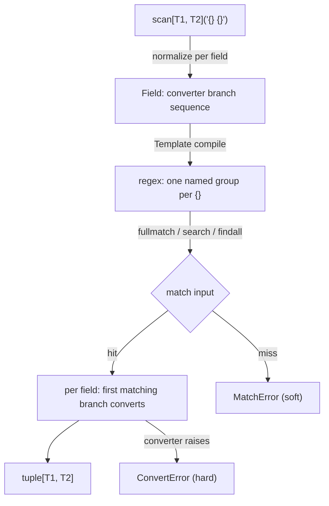

# InfinityParse — Core Overview

## Overview

InfinityParse is a `scanf`-style string parsing library: every `{}` placeholder in a
template corresponds to one type argument, and the type argument doubles as the
field's converter. Parsing happens in three steps — compile the template, match the
input, convert each field — all driven by type annotations, with runtime behavior
mirroring what pyright strict infers.

Main building blocks:

- **Scanner**: the `scan` / `search` / `scanall` entry points and the `Scanner`
  class — match input and return `tuple[...]`.
- **Engine**: `Converter` / `Field` / `Template` — per-field configuration,
  template compilation and the error model.
- **parse_types**: a curated converter catalog (date-times, numbers, character
  classes, …).
- **combinators**: `alt` / `recursive` / `split_top` / `sep_by` / `first_field` —
  compose scanners into larger parsers.

---

## Document Index

| Document | Contents |
| - | - |
| [scanner.md](scanner.md) | `scan` / `search` / `scanall` / `Scanner`: matching modes, template syntax, field declarations (`OneOf` / unions / aliases) |
| [engine.md](engine.md) | `Converter` per-field configuration, `Field` branch competition, `Template` compilation, error model and offsets |
| [parse_types.md](parse_types.md) | Curated types: character classes, date-times, numbers; `RegexString` / `DateTime` builders |
| [combinators.md](combinators.md) | `alt` / `recursive` / `split_top` / `sep_by` / `first_field` and `Parser[T]` |

---

## Core Component Relationships



### Scan Flow

```text
scan[int, float]("{} {}")("1 2.5")
  │
  ▼
resolve_field: normalize each field's type annotation → Field (converter branches)
  │
  ▼
Template compile: template text → regex (one named group per {}; branches in order)
  │
  ▼
fullmatch the whole input (after stripping it)
  │
  ├─ no match → MatchError (soft failure)
  │
  └─ match → per field, pick the first branch whose pattern matched, then convert
       ├─ ok → strongly-typed tuple (1, 2.5)
       └─ converter raises → ConvertError (field number, text, offset, label)
```

## Quick Example

Declare fields with custom patterns via `Annotated` + `Converter`:

```python
from typing import Annotated

from infinity_parse import Converter, scan

parse = scan[
    Annotated[int, Converter(int, pattern=r"\d+", name="age")],
    Annotated[str, Converter(str, pattern=r'"[^"]*"', name="name")],
]("age={} name={}")

age, name = parse('age=42 name="kim"')
# 42 (int), '"kim"' (str)
```

Or simply — the type itself is the converter:

```python
from infinity_parse import scan

program, errors, warns = scan[str, int, int]("{} - {} errors, {} warnings")(
    "/usr/sbin/sendmail - 0 errors, 4 warnings"
)
# ('/usr/sbin/sendmail', 0, 4)
```

## Workflow

1. **Declare fields** — one converter type per `{}`: built-in types (`int` / `float` /
   `str` / `bool` / containers), curated types (`t.Int` / `t.SimpleDate`…), or
   `Annotated[T, Converter(...)]` for custom patterns and labels.
2. **Build a parser** — `scan[...]("template")` returns a reusable parser.
3. **Pick a matching mode** — `scan` for a full match, `search` for the first match,
   `scanall` for every match; see [scanner.md](scanner.md).
4. **Handle errors** — a template miss raises `MatchError` (which `alt` may swallow);
   a conversion failure raises `ConvertError` (hard failure, never falls back). Both
   are `ScanError` (a `ValueError` subclass).
5. **Scale up** — compose scanners into recursive grammars with
   [combinators](combinators.md).

## Key Features

- **Type safety**: field types are converter types; results are `tuple[T1, T2, ...]`.
  pyright strict with zero suppressions; `assert_type` can assert the inference.
- **Three matching modes**: full match / first search / scan all, all driven by one
  template.
- **Per-field configuration**: `Converter` carries the conversion callable, capture
  pattern, `strip` flag, `re` flags and an error label.
- **Competing branches**: `OneOf` and `|` unions pack multiple converter branches
  into one field; they compete in declaration order and the first matching pattern
  wins.
- **Curated types**: `parse_types` ships date-times (ISO 8601 / RFC 2822 / ctime /
  HTTP log / syslog), numbers (thousands separators, percents, bases, floats) and
  character classes.
- **Composable**: `alt` / `recursive` / `split_top` / `sep_by` / `first_field` build
  parsers out of plain callables.
- **Zero dependencies**: standard library only; Python 3.14+ (PEP 695 generics).

## Notes

- `scan` strips the input first; `search` / `scanall` scan the raw input
  (see [scanner.md](scanner.md)).
- The default field pattern is `.+?`: non-empty, single-line, lazy — the shortest
  text that still lets the rest of the template match.
- Whitespace runs in the template match any whitespace run (`\s+`), newlines
  included; the default field pattern never matches a newline.
- Literal braces in a template are written `{{` and `}}`; a single brace is rejected
  at construction time.
- Converters must be callable and hashable (template compilation is cached).
- The two failure kinds are not interchangeable: `MatchError` is a soft failure,
  `ConvertError` is a hard failure (see [engine.md](engine.md)).
