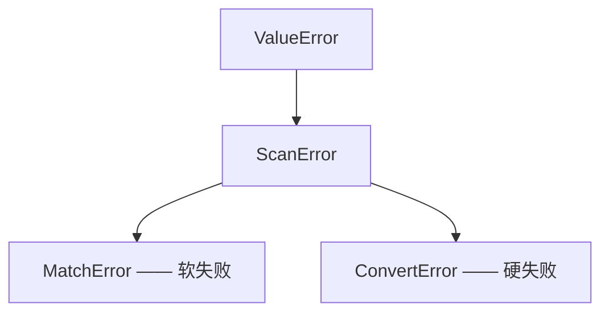

# Engine 引擎——转换器、模板与错误

## 概述

`engine` 模块是 InfinityParse 的运行时后盾：定义 `Converter`（字段级配置数据）、
`Field`（字段的转换器分支集合）、`Template`（编译后的模板）与错误层级。高层入口
[scanner](scanner.md) 在构造时把注解元数据归一化为 `Field` 序列，再交给
`Template` 编译。

---

## Converter——字段级配置

```python
@dataclass(frozen=True)
class Converter[T]:
    fn: Callable[[str], T]  # 转换函数：把捕获文本转成 T
    pattern: str = r".+?"  # 捕获模式（默认惰性、非空、单行）
    strip: bool = True  # 转换前是否 strip 捕获文本
    name: str | None = None  # 错误信息里的显示名
    flags: int = 0  # 作用于 pattern 的 re 标志
```

| 参数 | 类型 | 默认 | 说明 |
| - | - | - | - |
| `fn` | `Callable[[str], T]` | （必需） | 转换函数。抛出的任何异常都会被包装为 `ConvertError`。 |
| `pattern` | `str` | `.+?` | 该分支的捕获模式；同一字段的多条分支各有自己的模式。 |
| `strip` | `bool` | `True` | 转换前对捕获文本做 strip；`False` 保留原始空白（如 `t.Whitespace` 需要保留空白）。 |
| `name` | `str \| None` | `None` | 错误信息里的显示名；缺省回退到 `fn.__name__`。 |
| `flags` | `int` | `0` | `re` 标志，作用于该分支自己的模式。支持内联子集 `i` / `m` / `s` / `x` / `a`；超出子集的位在编译时抛 `ValueError`。 |

用法示例：

```python
import json
import re
from typing import Annotated

from infinity_parse import Converter, scan

# 自定义转换函数（例如 JSON 而不是 Python 字面量）
scan[Annotated[dict[str, str], Converter(json.loads, name="json")]]("{}")(
    '{"key": "value"}'
)  # ({"key": "value"},)

# 自定义模式 + 显示名（让错误信息更好读）
scan[Annotated[int, Converter(int, pattern=r"\d+", name="age")]]("age={}")(
    "age=42"
)  # (42,)

# strip=False：保留字段内的原始空白
scan[Annotated[str, Converter(str, strip=False)]]("{}!")("hi !")  # ("hi ",)

# flags：作用于该分支自己的模式
scan[Annotated[str, Converter(str, pattern=r"[a-z]+", flags=re.IGNORECASE)]]("{}")(
    "HeLLo"
)  # ("HeLLo",)
```

> `Converter` 是冻结数据类：可安全保存、复用；它参与模板编译缓存，因此 `fn`
> 必须可哈希。

### 感知转义的字符串字段

把模式扩展为转义感知，再配合 `json.loads` 解码转义序列；非法转义由转换器硬失败
（不会静默吞掉）：

```python
import json
from typing import Annotated

from infinity_parse import Converter, scan

parse_name = scan[
    Annotated[str, Converter(json.loads, pattern=r'"(?:[^"\\]|\\.)*"', name="name")]
]("{}")

parse_name(r'"kim \"the fox\""')  # ('kim "the fox"',)
parse_name(r'"C:\\path\\to\\file"')  # ('C:\\path\\to\\file',)
```

### 转换器里嵌扫描器

`Converter.fn` 可以是另一个扫描器——字段整体先由外层模式捕获，再交给内层扫描器解析：

```python
from typing import Annotated

from infinity_parse import Converter, scan

point = scan[int, int]("{} {}")
parse = scan[
    Annotated[
        tuple[int, int], Converter(point, pattern=r"(?<=\[).+?(?=\])", name="point")
    ]
]("point=[{}]")

parse("point=[1 2]")  # ((1, 2),)
```

内层失败会以 `ConvertError` 的形式冒泡，`__cause__` 链指向内层 `ScanError`。

---

## Field——转换器分支集合

```python
@dataclass(frozen=True)
class Field:
    converters: tuple[Converter[Any], ...]  # 按竞争顺序排列；至少一条
```

- 单分支字段：该分支即字段的全部行为。
- 多分支字段：按声明顺序竞争；**首个模式匹配的分支胜出**；胜出分支转换失败则整个
  扫描失败（不回退）。
- 多分支来自 `OneOf` 或 `|` 联合（见 [scanner.md](scanner.md)）。
- `Field` 与 `Converter` 一样必须可哈希。

---

## Template——编译后的模板

```python
class Template:
    def __init__(self, template: str, fields: tuple[Field, ...]) -> None
    def fullmatch(self, input_value: str) -> tuple[Any, ...]
    def search(self, input_value: str) -> tuple[Any, ...] | None
    def findall(self, input_value: str) -> list[tuple[Any, ...]]
```

构造时一次性完成全部校验，之后匹配无解析开销：

| 校验 | 失败类型 | 信息 |
| - | - | - |
| 占位符数量与字段数量不符 | `ValueError` | `... has N placeholder(s) but M converter type(s) were given` |
| 单个 `{` / `}` | `ValueError` | `single '{' in template ...` |
| 转换器不可调用 | `TypeError` | `converters must be callable` |
| 字段没有转换器 | `ValueError` | `each field requires at least one converter` |
| 模式非法（正则错误） | `re.error` | 由 `re.compile` 抛出 |
| 转换器不可哈希 | `TypeError` | — |

编译细节（了解即可）：

- 模板被切分为「字面段」与「占位符」；字面段做 `re.escape`，其中空白串转为 `\s+`。
- 每个字段生成一个命名分组 `s0` / `s1` / …；多分支时每个分支再各有一个命名分组
  （`s0b0`、`s0b1`…）用于判定胜出分支。
- `flags` 通过作用域内联标志 `(?i:...)` 绑定到分支自己的模式，不会污染其它分支。
- 编译带 LRU 缓存（最多 1024 个模板）。

## 错误模型



| 错误 | 含义 | 典型触发 | 会被 `alt` 吞掉吗 |
| - | - | - | - |
| `MatchError` | 输入与模板不匹配 | 全串匹配失败 / 搜索无果 | ✅ 会（`alt` 继续尝试其它分支） |
| `ConvertError` | 字段已匹配但转换失败 | 转换器抛出异常、非法转义等 | ❌ 不会（硬失败，立即中止） |

`ConvertError` 的信息包含字段序号、文本、偏移与显示名：

```python
scan[int, int]("{} {}")("1 zz")
# ConvertError: cannot convert field 2 ('zz') at offset 2 using int
```

| 片段 | 含义 |
| - | - |
| `field 2` | 第 2 个 `{}`（从 1 开始） |
| `'zz'` | strip 后用于转换的文本 |
| `offset 2` | 该字段捕获文本在**原始输入**中的起始下标（`scan` 自动补偿 strip 造成的位移） |
| `using int` | 分支显示名（`Converter.name` 或 `fn.__name__`） |

- 原始异常保存在 `__cause__`：如 `ValueError`、`SyntaxError`、`json.JSONDecodeError`。
- `search` / `findall` 的偏移同样相对原始输入（不补偿 strip）。
- 嵌套扫描器的错误会形成 `__cause__` 链。

## 低层构建

需要绕开 `scan[...]` 直接构建时，组合 `resolve_field` / `Field` / `Template` 即可：

```python
from infinity_parse import Converter, Template, resolve_field
from infinity_parse.engine import Field

field = resolve_field(int, [Converter(int, pattern=r"\d+", name="x")])
template = Template("x={}", (field,))

template.fullmatch("x=42")  # (42,)
template.search("x=42!")  # (42,)
template.findall("x=1, x=2")  # [(1,), (2,)]
```

也可以手工构造分支：

```python
field = Field(converters=(Converter(int, pattern=r"\d+", name="x"),))
```

## 注意事项

- 转换失败永远不回退：需要「多模式尝试」请显式使用 `OneOf` 分支，并确保每条分支的
  模式写准。
- `flags` 只支持 `i` / `m` / `s` / `x` / `a` 五个内联标志；其余标志位报 `ValueError`。
- `Template` 直接使用时返回 `tuple[Any, ...]`；要获得精确的推导类型请使用
  [scanner](scanner.md) 入口。
- `Field` / `Converter` 是冻结数据类，可安全地作为常量复用。
