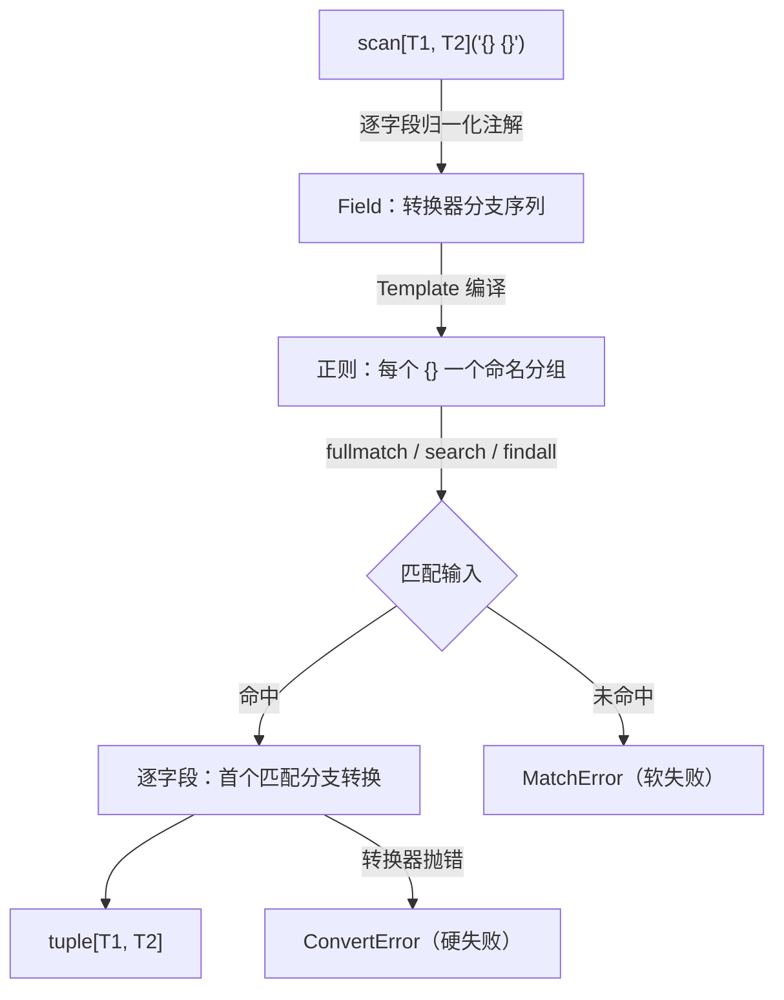

# InfinityParse 核心总览

## 概述

InfinityParse 是一个 `scanf` 风格的字符串解析库：模板里的每个 `{}` 占位符对应一个
类型参数，类型参数同时充当该字段的转换器。解析分三步——编译模板、匹配输入、逐字段
转换——全部围绕类型注解展开，运行时行为与类型检查器（pyright strict）的推导保持一致。

主要构件：

- **Scanner**：`scan` / `search` / `scanall` 三种入口与 `Scanner` 类，负责匹配并返回
  `tuple[...]`；
- **Engine**：`Converter` / `Field` / `Template`，负责字段级配置、模板编译与错误模型；
- **parse_types**：转换器精选类型目录（日期时间、数字、字符类等）；
- **combinators**：`alt` / `recursive` / `split_top` / `sep_by` / `first_field`，
  把扫描器组合成更大的解析器。

---

## 文档索引

| 文档 | 内容 |
| - | - |
| [scanner.md](scanner.md) | `scan` / `search` / `scanall` / `Scanner`：匹配模式、模板语法、字段声明（`OneOf` / 联合 / 别名） |
| [engine.md](engine.md) | `Converter` 字段级配置、`Field` 竞争分支、`Template` 编译、错误模型与偏移量 |
| [parse_types.md](parse_types.md) | 精选类型目录：字符类、日期时间、数字；`RegexString` / `DateTime` 构建器 |
| [combinators.md](combinators.md) | `alt` / `recursive` / `split_top` / `sep_by` / `first_field` 与 `Parser[T]` |

---

## 核心组件关系



### 扫描流程

```text
scan[int, float]("{} {}")("1 2.5")
  │
  ▼
resolve_field 逐字段解析类型注解 → Field（转换器分支序列）
  │
  ▼
Template 编译：模板文本 → 正则（每个 {} 一个命名分组，分支按声明顺序排列）
  │
  ▼
fullmatch 整串匹配（先对输入做 strip）
  │
  ├─ 未匹配 → MatchError（软失败）
  │
  └─ 已匹配 → 逐字段选择首个匹配分支并转换
       ├─ 成功 → 强类型元组 (1, 2.5)
       └─ 转换器抛错 → ConvertError（附字段序号、文本、偏移与显示名）
```

## 快速示例

用 `Annotated` + `Converter` 声明带自定义模式的字段：

```python
from typing import Annotated

from infinity_parse import Converter, scan

parse = scan[
    Annotated[int, Converter(int, pattern=r"\d+", name="age")],
    Annotated[str, Converter(str, pattern=r'"[^"]*"', name="name")],
]("age={} name={}")

age, name = parse('age=42 name="kim"')
# 42 (int), '"kim"' (str)
```

更简单的写法——类型本身就是转换器：

```python
from infinity_parse import scan

program, errors, warns = scan[str, int, int]("{} - {} errors, {} warnings")(
    "/usr/sbin/sendmail - 0 errors, 4 warnings"
)
# ('/usr/sbin/sendmail', 0, 4)
```

## 工作流程

1. **声明字段**——每个 `{}` 配一个转换器类型：内置类型（`int` / `float` / `str` /
   `bool` / 容器）、精选类型（`t.Int` / `t.SimpleDate`…），或用
   `Annotated[T, Converter(...)]` 自定义捕获模式与显示名。
2. **构建解析器**——`scan[...]("模板")` 返回可复用解析器；同一解析器可反复调用。
3. **选择匹配模式**——`scan` 全串匹配、`search` 找首个、`scanall` 找全部，
   详见 [scanner.md](scanner.md)。
4. **处理错误**——匹配失败抛 `MatchError`（可被 `alt` 继续尝试）；转换失败抛
   `ConvertError`（硬失败，绝不回退）。两者都是 `ScanError`（`ValueError` 子类）。
5. **组合放大**——用 [combinators](combinators.md) 把扫描器拼成递归文法。

## 核心特性

- **类型安全**：字段类型即转换器类型，结果为 `tuple[T1, T2, ...]`；pyright strict
  零遮蔽，`assert_type` 可直接断言推导结果。
- **三种匹配模式**：全串匹配 / 首次搜索 / 遍历全部，均由同一模板驱动。
- **字段级配置**：`Converter` 提供转换函数、捕获模式、`strip` 开关、`re` 标志与
  错误显示名。
- **竞争分支**：`OneOf` 与 `|` 联合把多条转换器分支打包进一个字段，按声明顺序竞争，
  首个模式匹配的分支生效。
- **精选类型**：`parse_types` 内置日期时间（ISO 8601 / RFC 2822 / ctime / HTTP 日志 /
  syslog）、数字（千分位、百分数、进制、浮点）与字符类。
- **可组合**：`alt` / `recursive` / `split_top` / `sep_by` / `first_field` 用普通
  可调用对象拼装解析器。
- **零依赖**：仅依赖标准库；Python 3.14+（PEP 695 泛型语法）。

## 注意事项

- `scan` 会先对输入两端做 strip；`search` / `scanall` 不 strip 输入
  （见 [scanner.md](scanner.md)）。
- 字段默认模式 `.+?`：非空、单行、惰性——取「让剩余模板仍能匹配的最短文本」。
- 模板中的空白串按 `\s+` 匹配，换行也算空白；但字段默认模式不跨行。
- 模板中的字面花括号必须写成 `{{` 与 `}}`；单个花括号在构造时直接报错。
- 转换器必须可调用且可哈希（模板编译带缓存）。
- 两种失败语义不可混用：`MatchError` 是软失败，`ConvertError` 是硬失败
  （见 [engine.md](engine.md)）。
